# Test utilisateur synthétique – 22 octobre 2026

> **Mise à jour du 22 octobre 2026 (après relecture avec Simon).** La création de club ou d'équipe par un nouveau coach est **fermée volontairement** pour l'instant (éviter qu'une personne crée des comptes et des équipes en série). L'ex-bloquant **B1 n'est donc plus un bloquant** : le choix est voulu, seul le message était à revoir (classé gênant). Bilan corrigé : **2 bloquants, 25 gênants, 33 mineurs** ; **aucune mission en échec non voulu**. Les corrections faites sont listées en section 8.

## 1. En-tête

- **Date** : jeudi 22 octobre 2026.
- **Ce qui a été testé** : l'appli Rugbeo lancée en local (sur l'ordinateur de test), branchée sur la **base de test** (rugbeo-test), jamais sur la production. Le bandeau orange « Environnement de test » a été vérifié sur la première capture de chaque testeur. Comptes fictifs du club « RC Test ». **Aucune notification ni aucun e-mail réel n'est parti.**
- **Méthode** : six « testeurs » sont des agents d'IA qui jouent chacun un personnage (une *persona*) et réalisent des missions en commentant à voix haute, avec une capture d'écran à chaque étape.

| Persona | Profil | Appareil simulé |
|---|---|---|
| Michel | 58 ans, coach bénévole des Séniors, impatient | Android (Galaxy A55) |
| Lucas | 19 ans, joueur Séniors | iPhone 13, **réseau 3G lent** simulé |
| Sandrine | Présidente du club | Ordinateur (1440 × 900) |
| Emma et Karim | Emma, 14 ans (U15), avec son père Karim | Android (Galaxy A55) |
| Thomas | Coach qui découvre l'éditeur de stratégies | Ordinateur (1366 × 768), puis iPhone 13 |
| Audit | Revue des 10 règles d'ergonomie de Nielsen + audit d'accessibilité automatique (axe-core) | iPhone 13 et ordinateur, en mode clair et sombre |

- **Captures** : `captures/2026-10-22/<persona>/` (les liens ci-dessous partent de ce dossier `docs/tests-utilisateurs/`).

### Conditions du test (adaptations du protocole)

- **Inscription d'Emma et Karim simulée** : le service d'inscription refuse les adresses de test. Le formulaire a été rempli pour de vrai, mais l'envoi final a été intercepté et remplacé par une fausse réponse. Le test a continué avec un compte parent déjà préparé (comme si Karim avait cliqué sur le lien de l'e-mail).
- **Lucas** : un script jouait le coach qui valide sa demande d'adhésion, et Lucas avait été placé n°11 dans la compo publiée.
- **Michel** : missions 1 à 3 avec un compte neuf (sans équipe), puis le compte du coach de l'équipe Séniors déjà remplie pour pouvoir continuer.
- **Pas de match le week-end** dans la base de test : le prochain match était le **lundi 26 octobre**. Les testeurs ont pris celui-là.
- **Dates et heures au format américain** (« 10/23/2026 », « 07:00 PM ») : elles viennent probablement du navigateur de test, pas de l'appli. À vérifier sur un vrai téléphone (voir section 4).
- **Les testeurs travaillaient en même temps sur la même base** : des chiffres (« 2 sans réponse » devenu « 1 sans réponse », etc.) ont pu changer à cause d'un autre testeur.
- **Incident** : le script d'audit a cliqué par erreur sur « Refuser » dans les demandes d'adhésion en attente (il cherchait le « Refuser » du bandeau cookies). Deux demandes (Karim et Michel) ont très probablement été refusées. Cela ne concerne que les données de test ; pour les remettre, lancer `select public.test_seed();` sur la base de test.

### Limites

- **C'est un test synthétique, pas un test avec de vraies personnes.** Les agents imitent bien les réactions courantes, mais ils peuvent se tromper sur ce qui gêne vraiment un coach de 58 ans ou une joueuse de 14 ans. **Je vous recommande de confirmer les points « Bloquant » et les 5 corrections prioritaires avec 2 ou 3 vrais utilisateurs** (par exemple un coach, un joueur et un parent du club), 15 minutes chacun suffisent.
- Les téléphones sont simulés dans un navigateur d'ordinateur : pas de vrai clavier tactile, pas de vrai réseau mobile, pas de lecteur d'écran réel (VoiceOver, TalkBack).
- Les actions qui suppriment ou envoient (annuler un événement, retirer un membre, relancer) n'ont pas toutes été déclenchées : leurs fenêtres de confirmation n'ont pas été évaluées.

---

## 2. Résumé

- Les missions **du quotidien marchent** : répondre Présent, trouver sa place dans la compo, inviter des joueurs, créer un entraînement, imprimer la feuille de match, créer une équipe (côté bureau).
- **Deux blocages** (plus un choix volontaire) : la création d'équipe est **fermée volontairement** pour un nouveau coach, mais l'appli ne lui disait pas à qui demander le code ; sur un réseau lent, l'appli met **environ 17 secondes** à afficher quelque chose ; les fiches (événements, membres, stratégies) **ne s'ouvrent pas au clavier**.
- Le défaut le plus partagé (6 testeurs sur 6) : **trop de fenêtres à la première connexion**, parfois empilées (cookies, « Nos conditions évoluent » en double, tutoriel, notifications).
- Deux points peuvent créer de vrais incidents sur le terrain : l'**heure de rendez-vous diffère** entre l'agenda (12h30) et la feuille de match (13h30), et « **Relancer** » n'envoie rien quand personne n'a activé les notifications.
- Côté stratégies, le joueur **croit qu'il n'y a rien** (l'onglet ouvert par défaut est vide) et le coach **ne trouve pas « Publier »** dans l'éditeur.
- L'accessibilité est correcte sur le fond (focus visible, langue, zoom), mais les **contrastes sont juste sous le seuil**, surtout en mode sombre. Six variables de couleur suffisent à corriger.
- Note d'ergonomie globale : **26/40** (règles de Nielsen).

---

## 3. Tableau des missions par persona

| Persona | Mission | Réussite | Étapes | Aurait abandonné ? |
|---|---|---|---|---|
| Michel | 1. Créer son équipe Séniors (compte neuf) | **Non (voulu : création sur invitation)** | 5 (4 essais) | **Oui**, au bout d'environ une minute |
| Michel | 2. Inviter des joueurs | Compte neuf : non (pas d'équipe). Compte coach : oui | 2 | Non |
| Michel | 3. Créer l'entraînement de mercredi 19h et la convocation | Compte neuf : non. Compte coach : oui, petite difficulté | 6 | Non, mais doute que la convocation soit partie |
| Michel | 4. Voir qui n'a pas répondu au match et relancer | Avec difficulté | 5 | Non, mais agacé (la relance ne part pas) |
| Michel | 5. Faire la feuille de match et l'imprimer | Oui | 4 | Non |
| Lucas | 1. Rejoindre l'équipe par le lien WhatsApp | Avec difficulté | 6 (+ 3 fenêtres à fermer) | **Presque** (17 s d'écran vide, puis formulaire d'inscription) |
| Lucas | 2. Répondre à la convocation du match | Avec difficulté | 3 | Non |
| Lucas | 3. Trouver sa place dans la compo | Oui | 2 | Non |
| Lucas | 4. Regarder la nouvelle combinaison | Avec difficulté | 4 | **Presque** (il a cru qu'il n'y avait rien) |
| Sandrine | 1. Comprendre ce que l'appli apporte au club | Avec difficulté | 9 | Non, mais la démo seule ne l'aurait pas convaincue |
| Sandrine | 2. Voir l'activité des équipes du club | Partiellement, avec difficulté | 7 | **Oui**, pour un vrai suivi (équipe par équipe) |
| Sandrine | 3. Ajouter une équipe | Oui | 4 | Non |
| Emma et Karim | 1. S'inscrire | Avec difficulté (c'est Karim qui crée le compte) | 9 (+ 1 erreur) | Emma seule : **oui**. Avec Karim : non |
| Emma et Karim | 2. Accord parental validé par Karim | Avec difficulté | 1 case + lien de l'e-mail (simulé) + connexion + 2 appuis | Non, mais Karim n'est pas sûr d'avoir donné l'accord |
| Emma et Karim | 3. Compléter le profil et rejoindre U16 | Profil : oui. Équipe : demande envoyée, en attente du coach | Profil 10, équipe 3 | Non |
| Thomas | a) Trouver l'éditeur | Oui, avec une gêne | 3 | Non |
| Thomas | b) Placer 2 joueurs et le ballon | Avec difficulté | 9 | Non |
| Thomas | c) Étapes 2 et 3, déplacements croisés | Oui | 4 | Non |
| Thomas | d) La passe | Avec difficulté | 6 | Hésitation forte |
| Thomas | e) Prévisualiser | Avec difficulté | 2 | Non |
| Thomas | f) Enregistrer et publier | Avec difficulté | 7 | Risque : croire qu'« Enregistrer » partage déjà |
| Thomas | g) Vérifier que l'équipe la voit | Oui | 2 | Non |
| Thomas | Téléphone : ouvrir l'éditeur et placer un joueur | Oui | 5 | Non (mais dessin perdu en quittant) |

---

## 4. Problèmes classés par gravité

Règle utilisée : **Bloquant** = la mission échoue ou un vrai utilisateur abandonnerait ; **Gênant** = réussite avec effort, erreur probable ou perte de confiance ; **Mineur** = détail de finition.

Total : **2 bloquants, 25 gênants, 33 mineurs** (doublons fusionnés ; B1 reclassé en gênant, voir ci-dessous).

### 4.1 Bloquants

#### B1. (Reclassé en gênant : création fermée volontairement) Un nouveau coach ne peut pas créer son équipe, et ne sait pas quoi faire

> Choix volontaire : la création est sur invitation pour éviter les comptes et équipes en série. Le défaut retenu est le **message** (bouton grisé, personne à qui demander), pas la fermeture.

- **Vu par** : Michel (et Sandrine, qui a eu peur de créer un deuxième club par le même bouton).
- **Description** : après connexion, l'appli dit « Dernière étape : rejoignez votre club ». « Créer le club » est grisé, avec en petit « Sur invitation pour le moment : demandez le code de votre club ». Michel monte justement l'équipe : il n'a pas de code et personne à qui le demander. Le bouton du menu profil « Rejoindre ou créer un club, une équipe » promet de créer, mais rouvre le même cadre grisé. Après 4 essais, Michel ferme l'appli.

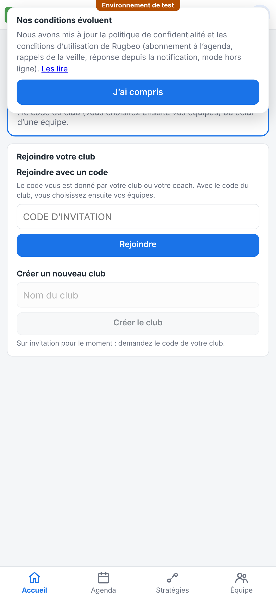

Autres captures : [menu profil](captures/2026-10-22/michel/07-menu-profil.png), [même cadre grisé](captures/2026-10-22/michel/08-rejoindre-ou-creer.png).

- **Correction proposée** (mise à jour) : garder la création fermée. Ne plus afficher de bouton grisé ; écrire « Pas de code ? Demandez-le au bureau de votre club ou à votre coach », et pour un club absent de Rugbeo un lien « écrivez-nous » (formulaire d'avis prérempli). Renommer le bouton du menu « Rejoindre un club ou une équipe ».

#### B2. Démarrage très lent sur réseau mobile faible (environ 17 secondes d'écran vide)
- **Vu par** : Lucas (3G simulée).
- **Description** : à chaque ouverture du lien ou de l'appli, l'écran n'affiche que le mot « Rugbeo » pendant 16 à 17 secondes (jusqu'à 20 s pour un écran utilisable), sans indicateur de chargement. Lucas : « Sur un vrai iPhone en 3G, je serais déjà reparti sur WhatsApp. » Il n'y a pas de capture de l'écran vide (la mesure vient du relevé du texte de la page seconde par seconde) ; la capture ci-dessous montre le premier écran utile.

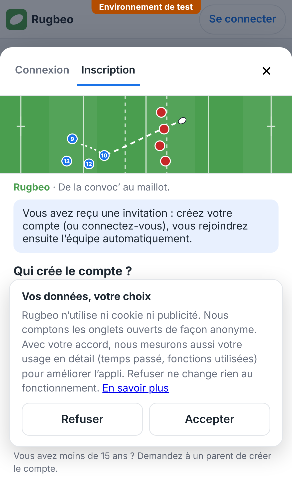

- **Attention** : l'appli tournait en local pendant le test. Il faut **refaire la mesure sur la version en ligne** (GitHub Pages) avec un téléphone en 3G ou en mode « réseau lent » du navigateur avant de chiffrer l'effort.
- **Correction proposée** : afficher tout de suite un écran de chargement (logo + « Chargement… ») ; charger d'abord ce qui sert à l'écran d'accueil et le reste après ; garder l'appli en mémoire sur le téléphone (mode hors ligne) pour que les ouvertures suivantes soient quasi immédiates.

#### B3. Les fiches ne s'ouvrent pas sans souris ni doigt (clavier, lecteur d'écran)
- **Vu par** : Audit.
- **Description** : les cartes des événements (Agenda), des compos, des stratégies, des membres et des étapes de l'éditeur s'ouvrent au clic, mais pas avec la touche Tab puis Entrée. Une personne qui navigue au clavier ou avec un lecteur d'écran (personne malvoyante) ne peut pas ouvrir une convocation. 36 cartes concernées côté coach sur téléphone.

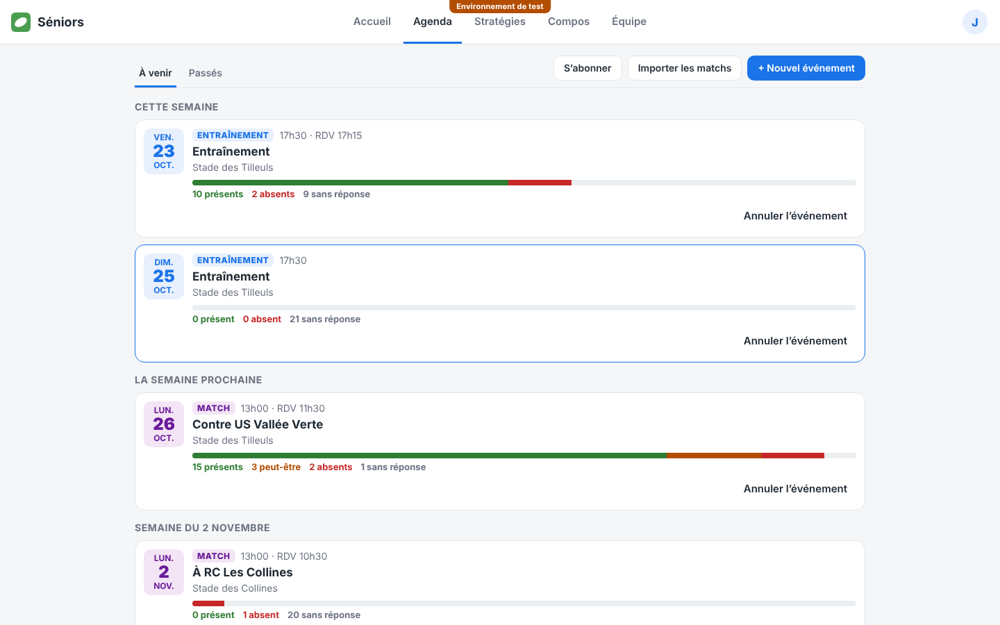

- **Correction proposée** : faire du titre de chaque carte un vrai lien (ou bouton) qui couvre la carte. Le reste de l'accessibilité est en section 5 (problème G24).

### 4.2 Gênants

#### G1. Trop de fenêtres à la première connexion, parfois empilées
- **Vu par** : Michel, Lucas, Sandrine, Emma et Karim, Thomas, Audit (6 sur 6).
- **Description** : jusqu'à 4 couches d'affilée ou en même temps : bandeau cookies, « Nos conditions évoluent » (parfois **deux fois empilé**, il faut appuyer deux fois sur « J'ai compris »), tutoriel de 8 à 11 étapes, puis « Restez informé » (notifications). Sur ordinateur, « Nos conditions évoluent » **cache le menu** (Accueil, Agenda…). Le tutoriel peut s'ouvrir quelques secondes après l'arrivée et « avaler » le clic en cours (Thomas). Ces fenêtres cachent justement les boutons Présent / Peut-être / Absent. Karim : « Ça bugue ? »

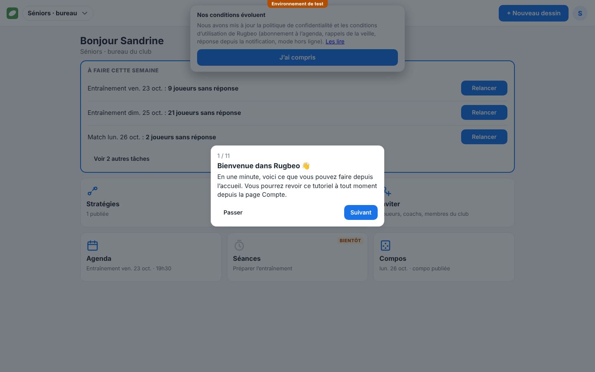

Autres captures : [bandeau en double (Karim)](captures/2026-10-22/emma/10-accueil-karim.png), [après le 1er « J'ai compris »](captures/2026-10-22/emma/14-premier-appui-jai-compris.png), [« Restez informé » sur les boutons de réponse (Lucas)](captures/2026-10-22/lucas/12-tuto-et-conditions.png), [menu caché sur ordinateur](captures/2026-10-22/audit/06b-coach-bandeau-conditions-masque-nav-ordi.png), [tutoriel qui bloque le clic (Thomas)](captures/2026-10-22/editeur/05-tutoriel-1.png).

- **Correction proposée** : **une seule fenêtre par visite**, dans l'ordre : cookies, puis conditions, puis rien d'autre. Le tutoriel devient une proposition (« Voir la visite en 1 minute ? ») et les notifications sont proposées **après** la première réponse à une convocation. Supprimer le doublon du bandeau des conditions, et le placer en bas de l'écran, jamais sur le menu.

#### G2. L'heure de rendez-vous n'est pas la même dans l'agenda et sur la feuille de match
- **Vu par** : Michel, Lucas.
- **Description** : le match dit « Rendez-vous à 12h30 », la feuille de match (et la feuille imprimée) dit « H RDV : 13h30 ». Lucas : « J'arrive à quelle heure du coup ? » Risque réel de retard de toute l'équipe. L'écart est d'une heure pile : il faut vérifier si la feuille reprend une heure saisie à part (donnée de test) ou s'il y a un décalage d'heure (heure d'été/hiver).

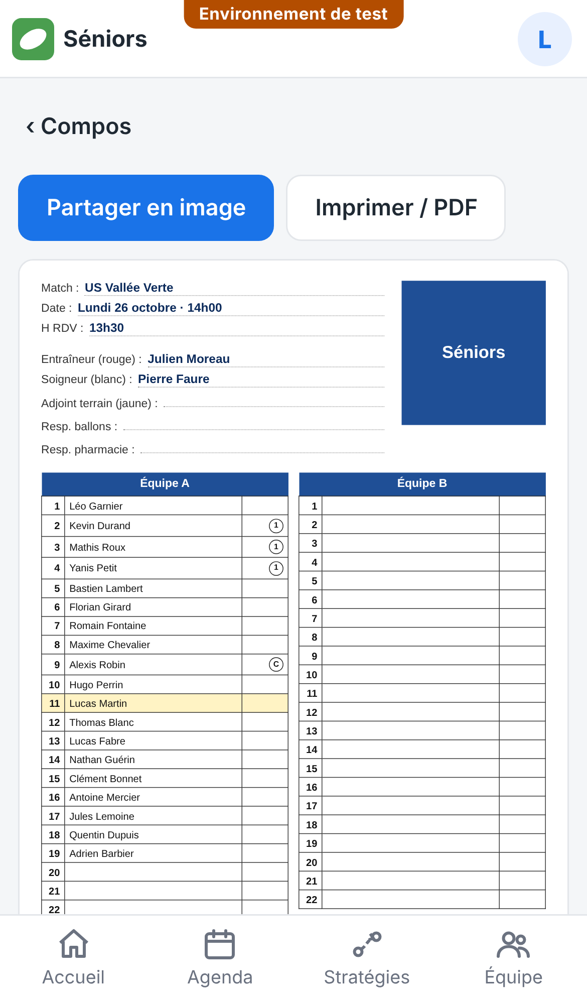

Autres captures : [fiche du match : rendez-vous 12h30](captures/2026-10-22/michel/15-apres-relance.png), [feuille imprimée](captures/2026-10-22/michel/20-impression.png).

- **Correction proposée** : la feuille de match reprend automatiquement l'heure de rendez-vous de l'événement. Si le coach la change sur la feuille, afficher « Différente de l'agenda (12h30) ».

#### G3. Le joueur croit qu'il n'y a pas de stratégie
- **Vu par** : Lucas.
- **Description** : la pastille rouge « 1 » sur Stratégies mène à « Mes dessins », **vide**, avec un gros bouton « + Nouveau ». La combinaison du coach est cachée dans le petit onglet gris « De l'équipe ». Le texte parle de « + Nouveau dessin » alors que le bouton s'appelle « + Nouveau ».

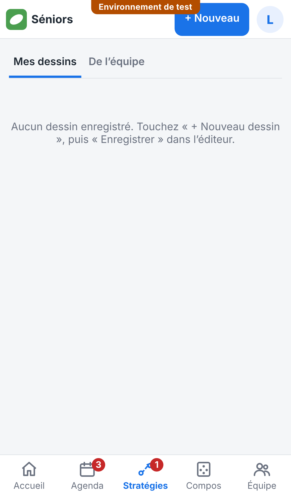

- **Correction proposée** : pour un joueur, ouvrir Stratégies sur « De l'équipe » (au moins quand une stratégie n'a pas été vue). Aligner le texte et le bouton.

#### G4. Le joueur se retrouve dans l'éditeur du coach
- **Vu par** : Lucas, Thomas.
- **Description** : en fermant l'aperçu d'une stratégie publiée, Lucas arrive dans l'éditeur avec « Enregistrer », « Exporter » et les outils : « J'ai le droit de toucher à sa combi ?! » Côté coach, ouvrir une stratégie depuis « De l'équipe » ouvre aussi l'éditeur : impossible de voir ce que verront les joueurs. Le 5e onglet du bas de l'éditeur porte le nom de la personne (« Lucas Martin »), sans qu'on comprenne pourquoi.

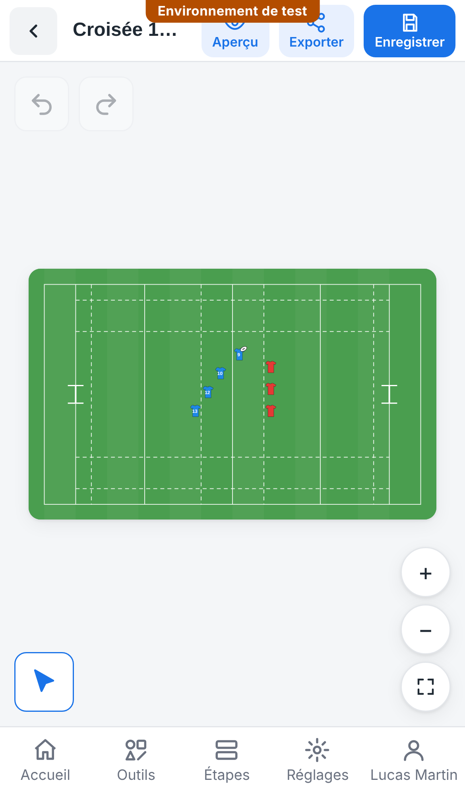

Autre capture : [ouverture depuis « De l'équipe » (Thomas)](captures/2026-10-22/editeur/43-ouverture-depuis-de-l-equipe.png).

- **Correction proposée** : une stratégie de l'équipe s'ouvre en **lecture** (l'animation), avec un bouton « Modifier » visible seulement pour son auteur ou un coach. Fermer l'aperçu ramène à la liste. Remplacer le nom dans l'onglet par « Compte ».

#### G5. « Relancer » ne relance personne, et le message tutoie
- **Vu par** : Michel.
- **Description** : Michel appuie sur « Relancer le joueur sans réponse ». Message : « Aucun de ces joueurs n'a activé les notifications : **utilise** « Copier pour WhatsApp » ». Rien n'est parti, et il ne l'apprend qu'après. Il doit ensuite copier, quitter l'appli, ouvrir WhatsApp, trouver le groupe et coller (« Message copié : **colle-le** dans le groupe WhatsApp »). Ces deux messages ne respectent pas la règle du vouvoiement. Le message copié ne contient pas de lien vers l'appli.

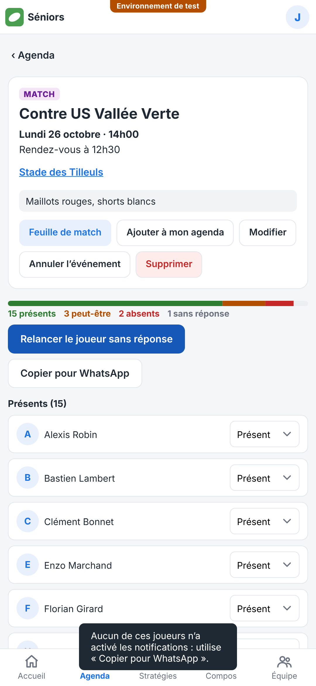

Autre capture : [Copier pour WhatsApp](captures/2026-10-22/michel/16-copier-whatsapp.png).

- **Correction proposée** : vouvoyer (« utilisez », « collez-le »). Quand personne ne recevra la relance, afficher directement un bouton « **Envoyer sur WhatsApp** » qui ouvre WhatsApp avec le message prêt (comme sur l'écran Inviter), et ajouter le lien de l'événement dans le message.

#### G6. Pas de « Publier » dans l'éditeur, et le dessin n'a pas de nom
- **Vu par** : Thomas.
- **Description** : « Enregistrer le dessin » enregistre sous le nom « Nouveau dessin », sans demander de nom ; le titre est modifiable mais ne ressemble pas à un champ. Thomas cherche « Publier » dans l'éditeur, puis dans « Exporter » : il n'y est pas. On ne publie que depuis la liste, sans confirmation. Ensuite l'étiquette « Dans l'appli seulement » n'est pas comprise (« les joueurs ne sont pas prévenus ? »).

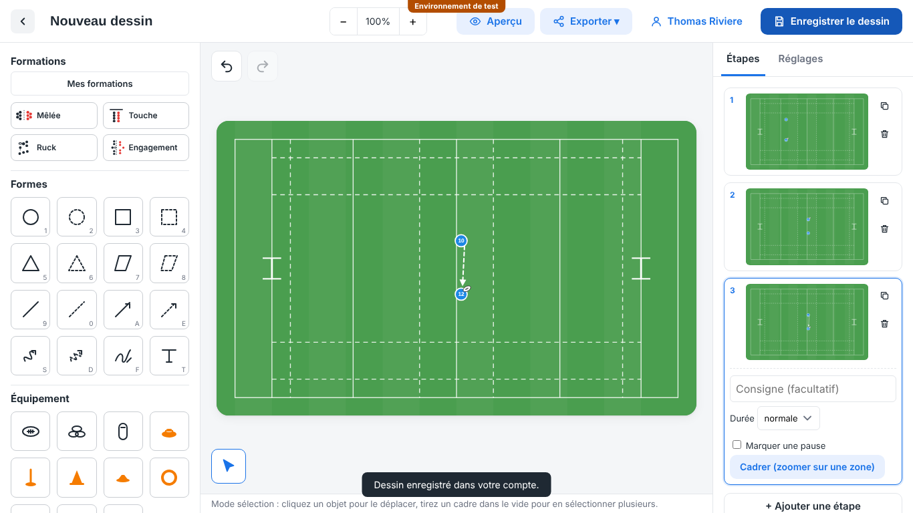

Autres captures : [menu Exporter](captures/2026-10-22/editeur/33-menu-exporter.png), [« Dans l'appli seulement »](captures/2026-10-22/editeur/40-mes-dessins-apres-publication.png).

- **Correction proposée** : au premier enregistrement, demander le nom (prérempli). Après l'enregistrement, proposer « Enregistré. **Publier à l'équipe ?** », avec le choix « Prévenir les joueurs : oui / non ». Ajouter un petit crayon sur le titre et « Renommer » dans le menu « ⋯ ». Remplacer « Dans l'appli seulement » par un libellé clair (par exemple « Joueurs non prévenus »).

#### G7. Quitter l'éditeur sans enregistrer perd le dessin, sans avertissement
- **Vu par** : Thomas (téléphone).
- **Description** : un appui sur « < » ramène à l'accueil sans rien demander, et le dessin est perdu. Sur le terrain, un appel ou une notification suffit.

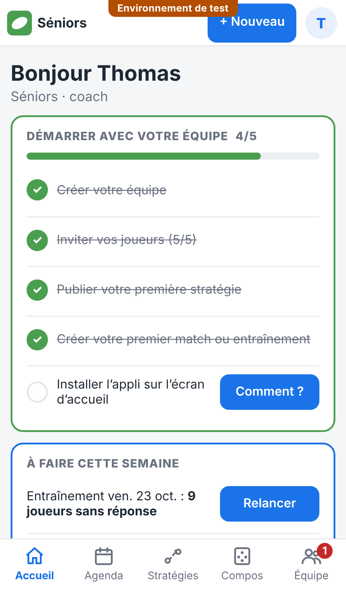

Autre capture : [dessin perdu à la réouverture](captures/2026-10-22/editeur/59-mobile-nouveau-dessin-rouvert.png).

- **Correction proposée** : demander « Quitter sans enregistrer ? » et garder un brouillon automatique.

#### G8. Les actions sensibles sont trop faciles à toucher par erreur
- **Vu par** : Michel, Sandrine, Emma et Karim, Audit.
- **Description** : « Annuler l'événement » est affiché sur **chaque carte** de l'Agenda (« avec mes gros doigts… », Michel) ; dans la fiche, « Modifier », « Annuler l'événement » et « Supprimer » sont collés (et « Annuler » se lit aussi « revenir en arrière ») ; dans Équipe, le rôle Joueur / Coach / Admin se change d'un geste et « Retirer » prend toute la largeur ; dans l'onglet Club, un bouton rouge « Retirer du club » sur chacune des 28 lignes ; dans « Mes jeunes », « Retirer » est collé à « Son profil » (Karim).

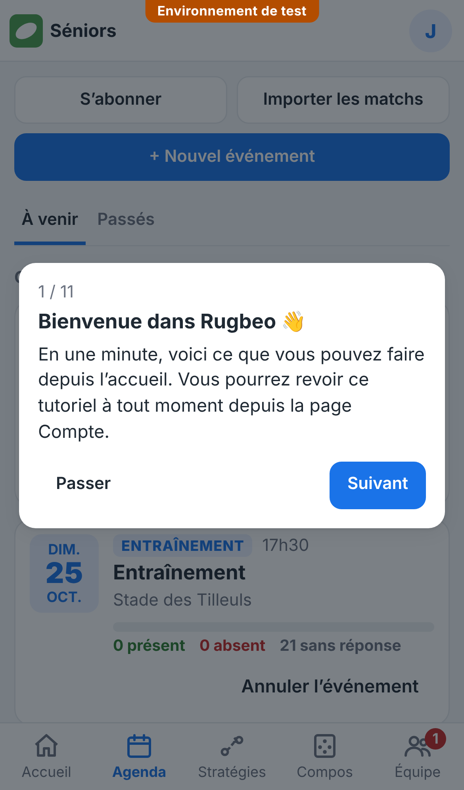

Autres captures : [fiche événement](captures/2026-10-22/audit/09-coach-evenement-tel.png), [membres](captures/2026-10-22/audit/14-coach-equipe-membres-tel.png), [onglet Club](captures/2026-10-22/sandrine/16-onglet-club.png), [Mes jeunes](captures/2026-10-22/emma/17-menu-compte.png).

- **Correction proposée** : retirer ces actions des listes ; les mettre dans la fiche, derrière un menu « ⋯ », avec une confirmation qui nomme la personne ou l'événement (« Retirer Thomas Riviere de Séniors ? »). Renommer « Annuler l'événement » en « Déclarer annulé ».

#### G9. La présidente n'a pas de vue d'ensemble du club
- **Vu par** : Sandrine.
- **Description** : l'onglet Club donne seulement « 24 membres · 1 en attente » par équipe. Les présences se consultent équipe par équipe en changeant d'équipe dans le sélecteur du haut. Son accueil est celui d'un coach (« Relancer », « + Nouveau dessin »). « Avec 8 équipes, je ne le ferais pas. »

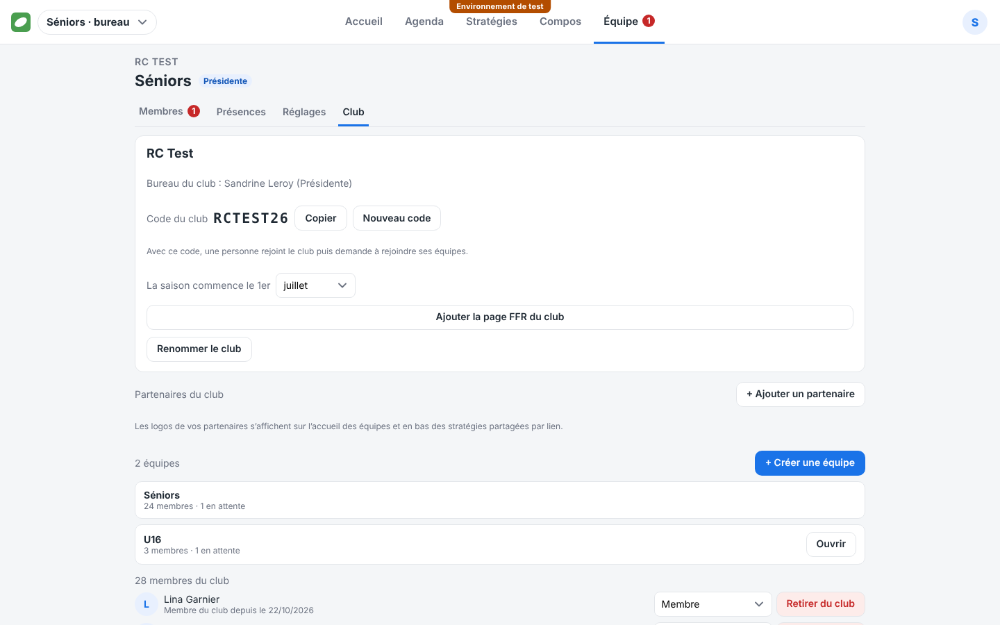

Autres captures : [accueil présidente](captures/2026-10-22/sandrine/12b-accueil-toutes-taches.png), [Présences d'une seule équipe](captures/2026-10-22/sandrine/15-equipe-presences.png).

- **Correction proposée** : dans l'onglet Club, un petit tableau par équipe : membres, événements des 30 derniers jours, taux de réponse, taux de présence, dernière activité du staff. Sur l'accueil du bureau, un encadré « Le club cette semaine ».

#### G10. La démo ne montre pas le club et semble cassée
- **Vu par** : Sandrine.
- **Description** : la démo est vue uniquement par un coach, avec une seule équipe, alors que la page d'accueil vante le multi-équipes. L'onglet Présences de la démo dit « Pas encore de joueur dans l'équipe » alors que 22 membres sont listés. Au tutoriel, à partir de l'étape 6, le bouton « Suivant » est caché par le bandeau noir « Démo · club fictif ».

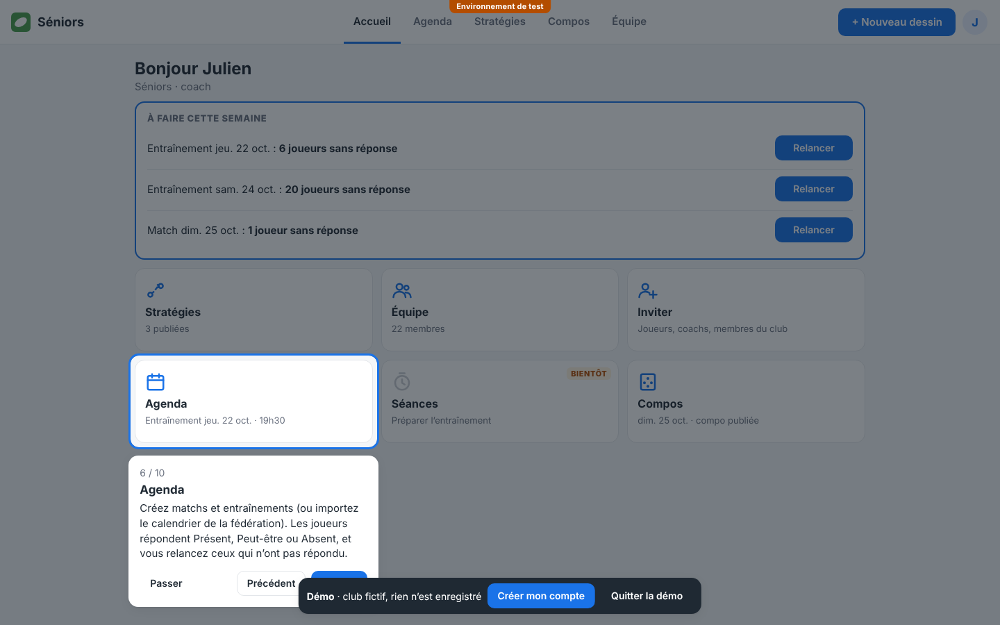

Autres captures : [Présences vides](captures/2026-10-22/sandrine/06-demo-presences.png), [démo vue par un coach](captures/2026-10-22/sandrine/02-demo.png).

- **Correction proposée** : placer la bulle du tutoriel au-dessus du bandeau ; remplir les présences de la démo ; proposer « Voir la démo comme coach / joueur / bureau du club » avec 2 ou 3 équipes.

#### G11. Rien n'est prévu pour un jeune de moins de 15 ans qui veut s'inscrire
- **Vu par** : Emma et Karim.
- **Description** : « Qui crée le compte ? » propose « J'ai 15 ans ou plus » et « Je suis parent ». Emma : « Y a pas mon bouton ! » La phrase « Vous avez moins de 15 ans ? Demandez à un parent » est en petit tout en bas, et cachée par le message « C'est noté : pas de mesure détaillée » (ou par le bandeau cookies si on n'y a pas répondu).

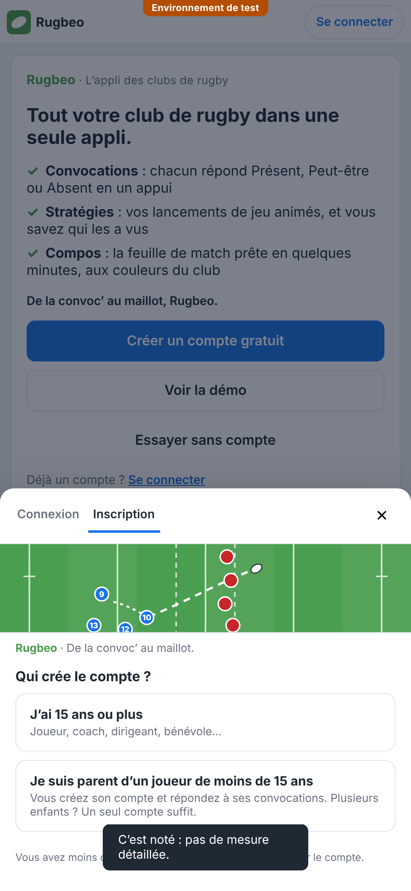

Autre capture : [caché par le bandeau cookies](captures/2026-10-22/emma/02c-bandeau-donnees-masque-choix.png).

- **Correction proposée** : ajouter une 3e carte « J'ai moins de 15 ans » qui explique qu'il faut un parent, avec un bouton « Envoyer ce lien à mon parent ».

#### G12. Le lien d'invitation ouvre « Inscription », même pour qui a déjà un compte
- **Vu par** : Lucas.
- **Description** : le lien WhatsApp du coach ouvre l'onglet « Inscription » et « Qui crée le compte ? ». Lucas a déjà un compte et doit trouver le petit onglet « Connexion ».

- **Correction proposée** : sur le lien d'invitation, deux gros boutons de même taille : « J'ai déjà un compte » et « Créer mon compte ».

#### G13. Des écrans faux s'affichent pendant le chargement
- **Vu par** : Lucas.
- **Description** : après « Se connecter », le message « Connecté. » apparaît mais la page publique (« Créer un compte gratuit ») reste affichée environ 4 s : « Ça a marché ou pas ? » À la réouverture, l'accueil affiche quelques secondes « Dernière étape : rejoignez votre club » et le champ code, alors que Lucas est déjà accepté : « J'dois remettre le code ? » Même chose pour la barre du bas, qui passe de 4 à 5 onglets selon le chargement.

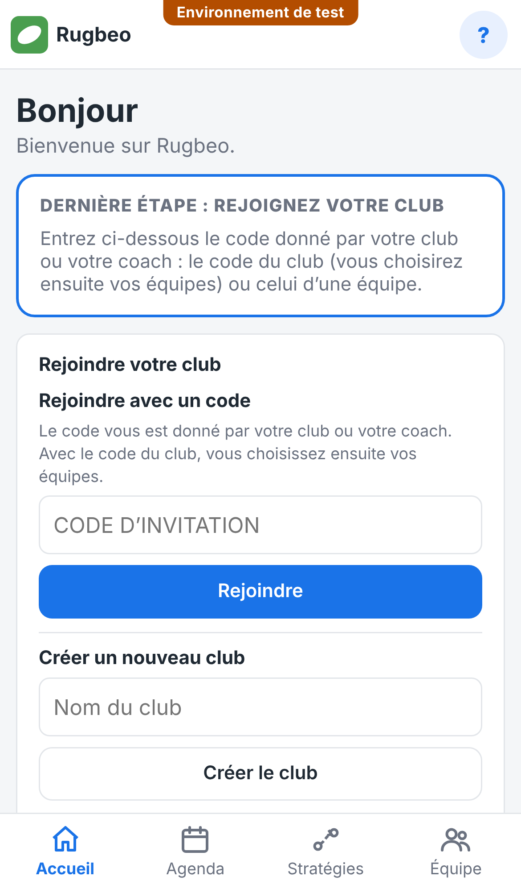

Autre capture : [« Connecté » mais page publique](captures/2026-10-22/lucas/07-apres-clic-1s.png).

- **Correction proposée** : tant que les informations du compte ne sont pas chargées, afficher un écran de chargement neutre (formes grises) plutôt qu'un écran « sans club » ; garder le bouton en « Connexion… » jusqu'à l'écran suivant.

#### G14. La page remonte tout en haut après une action
- **Vu par** : Lucas, Michel.
- **Description** : après « Présent » dans l'Agenda, la liste remonte en haut : Lucas ne voit pas son bouton devenir vert. Après « + Ajouter les présents » sur la compo, Michel est renvoyé en haut, sans message (« Ça marche, mais on ne me l'a pas dit »).

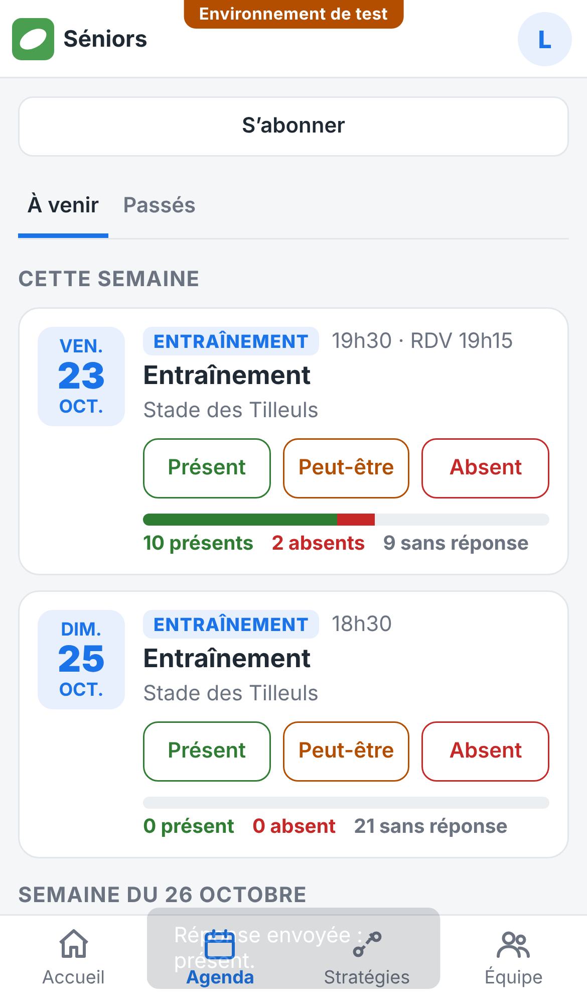

Autre capture : [après « Ajouter les présents »](captures/2026-10-22/michel/19-ajouter-presents.png).

- **Correction proposée** : garder la position dans la page après l'action, et afficher un message précis (« Enzo Marchand ajouté en n°20 »).

#### G15. Les joueurs « sans réponse » sont tout en bas de la liste
- **Vu par** : Michel.
- **Description** : il faut descendre sous les présents, les peut-être et les absents pour trouver qui n'a pas répondu. Toucher « 2 sans réponse » ne fait rien.

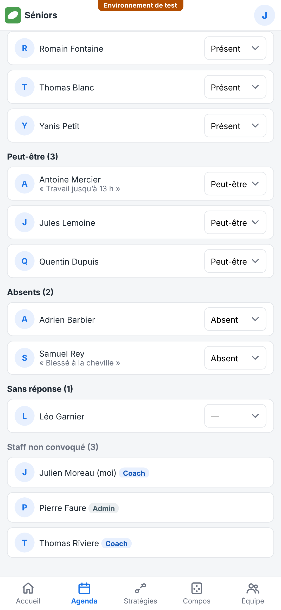

Autre capture : [appui sur le compteur sans effet](captures/2026-10-22/michel/13-clic-sans-reponse.png).

- **Correction proposée** : afficher les « Sans réponse » en premier (sous le bouton Relancer), et rendre les compteurs cliquables.

#### G16. Aucune confirmation que la convocation est partie
- **Vu par** : Michel.
- **Description** : en créant l'entraînement, la case s'appelle « Prévenir l'équipe par notification » (le mot « convocation » n'apparaît pas). Après l'enregistrement, rien ne dit à combien de joueurs elle est partie. Michel copie quand même le message pour WhatsApp « pour être sûr ».

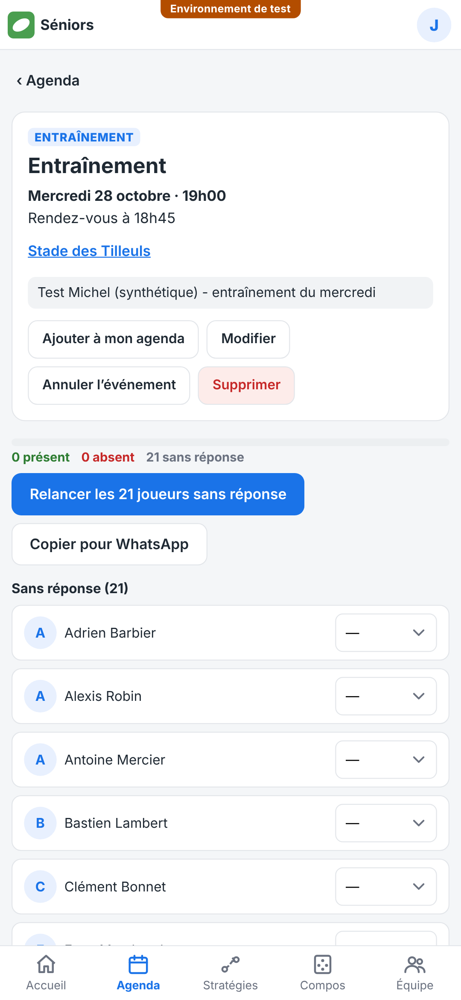

- **Correction proposée** : renommer la case « Envoyer la convocation à l'équipe » ; après l'enregistrement : « Convocation envoyée à 14 joueurs. 7 ne reçoivent pas les notifications : envoyer sur WhatsApp ».

#### G17. Un joueur qui n'a pas répondu est dans la compo sans alerte
- **Vu par** : Michel.
- **Description** : Léo Garnier est n°1 (pilier) alors qu'il n'a pas répondu, sans signal. L'absent (n°19) est signalé à l'écran, mais aucun des deux sur la feuille imprimée.

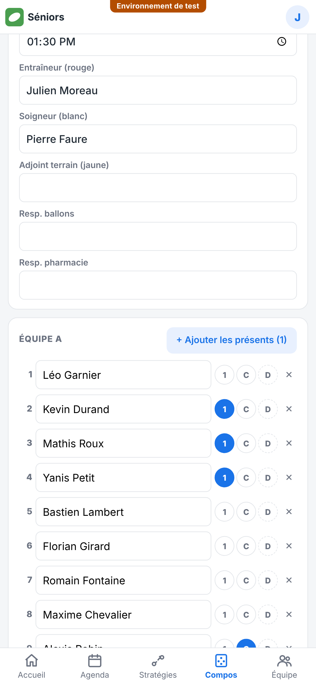

- **Correction proposée** : afficher « Sans réponse » à côté du nom, et avant d'imprimer ou de publier : « 1 joueur sans réponse et 1 absent dans la compo. Les retirer ? »

#### G18. Feuille de match difficile au doigt, avec des codes à deviner
- **Vu par** : Michel, Audit.
- **Description** : sur chaque ligne, trois ronds « 1 », « C », « D » (30 × 30 px) et une croix « ✕ » de retrait collée au « D ». Leur sens (1re ligne, Capitaine, Double) n'est expliqué qu'en bas de la liste, ou au survol de la souris (donc jamais sur téléphone). Risque de retirer un joueur en voulant le marquer.

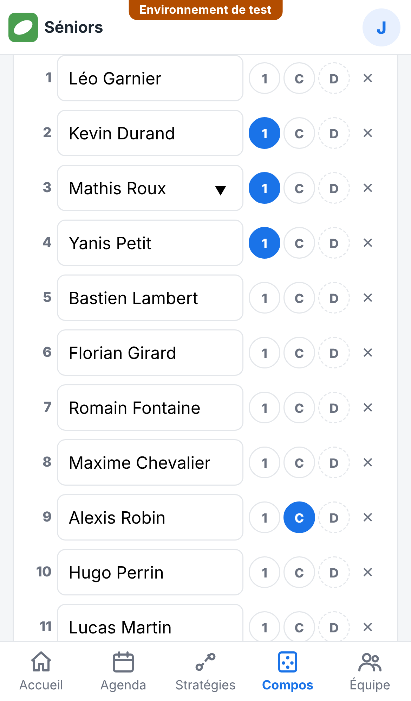

- **Correction proposée** : légende au-dessus de la liste ; ronds d'au moins 44 px ; la croix séparée des ronds (ou retrait par glissement avec « Annuler »).

#### G19. L'accord parental est peu clair
- **Vu par** : Emma et Karim.
- **Description** : l'accord se résume à une case « j'accepte, pour **lui**, la politique de confidentialité », sans rappeler le prénom ni dire ce que l'équipe verra de l'enfant. Ensuite, aucune trace de l'accord. Karim n'est pas sûr d'avoir « donné l'accord ».

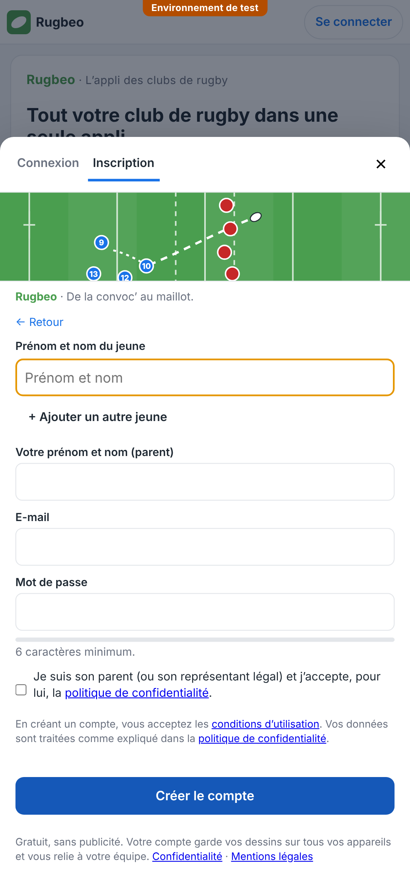

- **Correction proposée** : « Je suis le parent ou représentant légal d'Emma et j'accepte… » (prénom repris), 2 ou 3 puces sur ce que voient l'équipe et le staff, puis « Accord donné le 22/10/2026 » dans « Mes jeunes ». (Ce changement de texte touche aux données personnelles : vérifier s'il faut mettre à jour `js/legal.js`.)

#### G20. Le bouton « Choisir l'équipe de Emma » reste affiché après la demande
- **Vu par** : Emma et Karim.
- **Description** : sous « Dernière étape », le gros bouton bleu « Choisir l'équipe de Emma Benali » reste, alors que la demande U16 est déjà envoyée. En appuyant, on propose « Séniors, comme joueur » pour une ado de 14 ans. Petite faute : « de Emma » au lieu de « d'Emma ».

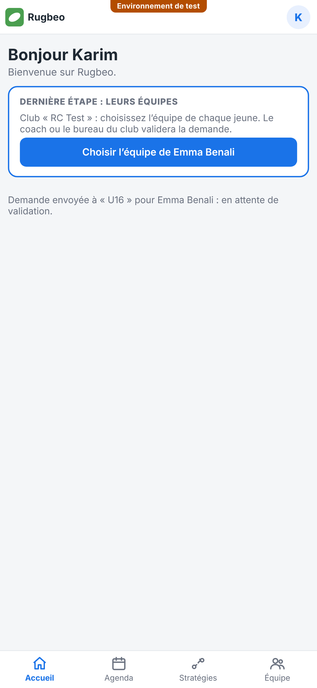

Autre capture : [Séniors proposé](captures/2026-10-22/emma/16-choisir-equipe-emma.png).

- **Correction proposée** : remplacer par « Demande envoyée à U16 : le coach doit la valider » ; corriger « d'Emma ».

#### G21. Éditeur : les joueurs sont difficiles à trouver et à manipuler
- **Vu par** : Thomas.
- **Description** : la section « Joueurs », l'outil le plus utilisé, est sous le pli sur ordinateur (après Formations, Formes, Équipement) et tout en bas du panneau « Outils » sur téléphone. Sur téléphone, la bulle « Joueur bleu : touchez le terrain pour placer » reste affichée et cache les boutons du joueur (Devant, Derrière, Supprimer), même 4 secondes après.

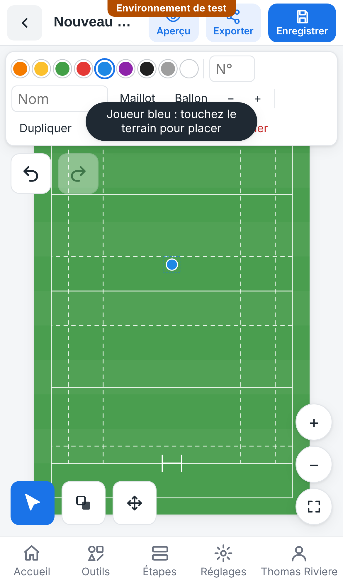

Autres captures : [Joueurs sous le pli (ordinateur)](captures/2026-10-22/editeur/08-editeur-ouvert.png), [Joueurs en bas des Outils (téléphone)](captures/2026-10-22/editeur/53-mobile-joueurs-dans-outils.png).

- **Correction proposée** : mettre « Joueurs » (et le ballon) en premier ; masquer la bulle dès qu'un joueur est posé.

#### G22. Éditeur : deux ballons sur le terrain, et aperçu figé
- **Vu par** : Thomas.
- **Description** : donner le ballon au n°12 le laisse aussi au n°10 (« il n'y a qu'un ballon ! »). L'« Aperçu » s'ouvre figé sur la dernière étape ; il faut trouver « Lire ».

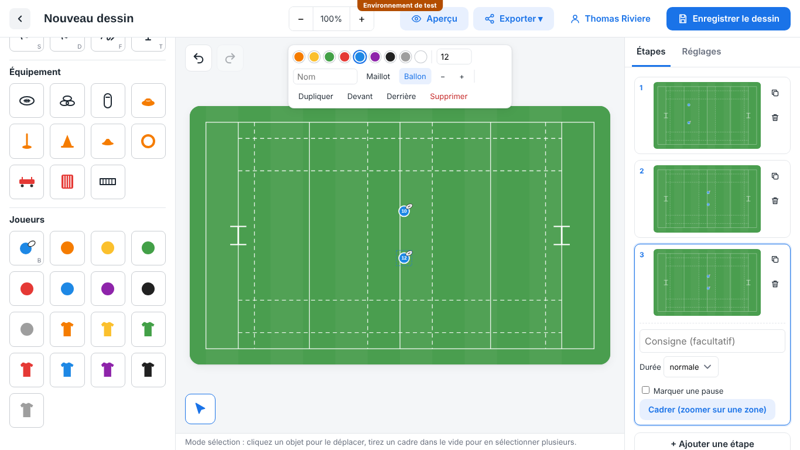

Autre capture : [aperçu figé sur 3/3](captures/2026-10-22/editeur/22-apercu-debut.png).

- **Correction proposée** : un seul porteur de ballon par étape (le donner à un joueur le retire aux autres) ; lancer l'animation depuis l'étape 1 à l'ouverture de l'aperçu.

#### G23. Contrastes juste sous le seuil, surtout en mode sombre
- **Vu par** : Audit.
- **Description** : en mode clair, le gris des textes secondaires (onglets inactifs, sous-titres) et les boutons bleu sur bleu pâle (« Feuille de match », « Voir la compo ») sont un peu trop pâles. En mode sombre, **tous les boutons bleus** et les couleurs **Présent / Peut-être / Absent** sont juste sous le seuil de lisibilité (4,2 au lieu de 4,5). Détail en section 5.

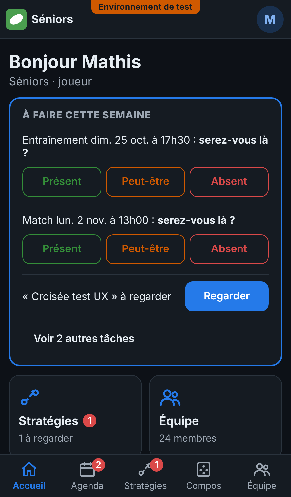

- **Correction proposée** : ajuster 6 variables de couleur dans `:root` (et leur version sombre), valeurs proposées en section 5. Pas de nouvelle couleur, conforme à la charte.

#### G24. Structure peu lisible pour un lecteur d'écran
- **Vu par** : Audit.
- **Description** : la fenêtre de connexion ne se ferme pas avec Échap et le curseur reste derrière ; le message « E-mail ou mot de passe incorrect » n'est pas annoncé ; la plupart des écrans n'ont pas de titre principal et le titre de l'onglet du navigateur ne change jamais ; les 23 listes « rôle » des membres et les 21 listes « réponse » d'un événement n'ont pas de nom (« liste déroulante, Coach », sans dire de qui).

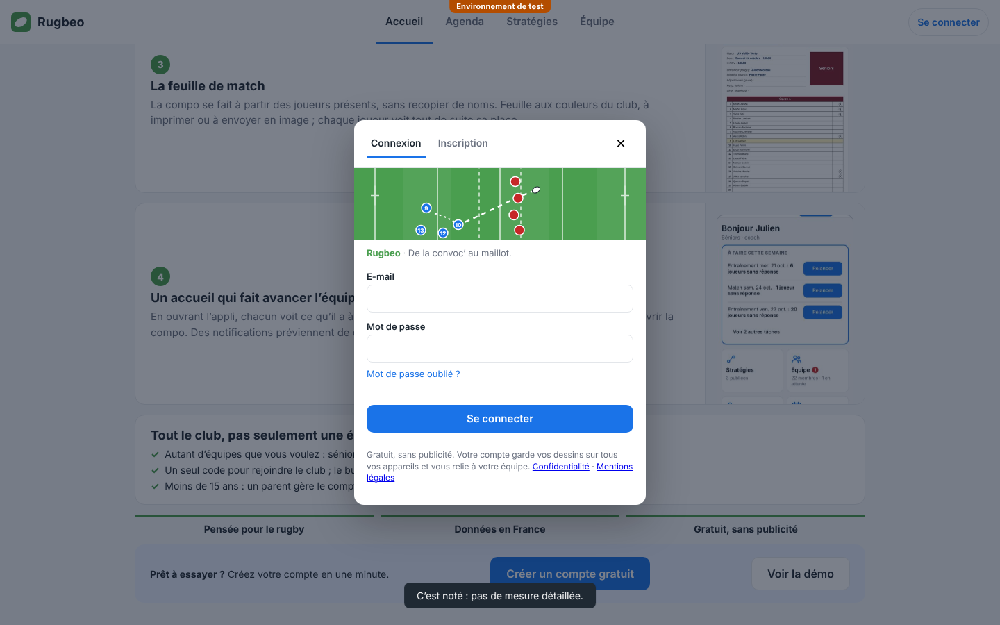

Autre capture : [message d'erreur](captures/2026-10-22/audit/02b-visiteur-connexion-erreur-ordi.png).

- **Correction proposée** : une vraie fenêtre (Échap ferme, curseur dans le champ e-mail), message d'erreur annoncé, un titre par écran (« Agenda – Séniors – Rugbeo »), un nom pour chaque liste (« Rôle de Thomas Riviere »).

### 4.3 Mineurs

| # | Problème | Vu par | Capture | Correction proposée |
|---|---|---|---|---|
| M1 | Les messages temporaires (« C'est noté… », « Réponse envoyée : présent. », « Demande envoyée… ») recouvrent le bas des formulaires ou la barre d'onglets, en transparence. | Michel, Lucas, Emma, Audit | [lien](captures/2026-10-22/michel/02-ecran-connexion.png) | Les afficher au-dessus de la barre, opaques. |
| M2 | Feuille imprimée sur téléphone : plus large que l'écran, Équipe B vide coupée et imprimée quand même ; texte petit. | Michel, Lucas | [lien](captures/2026-10-22/michel/21-impression-complete.png) | Adapter à la largeur ; ne pas imprimer l'Équipe B si elle est vide. |
| M3 | Icônes de partage de l'invitation (WhatsApp, bulle, enveloppe) sans texte. | Michel | [lien](captures/2026-10-22/michel/23-inviter.png) | « WhatsApp », « SMS », « E-mail » sous les icônes. |
| M4 | Plein écran d'une stratégie en portrait : terrain petit, 2/3 de noir ; idem page publique. | Lucas, Audit | [lien](captures/2026-10-22/lucas/32-strategie-plein-ecran.png) | « Tournez votre téléphone » ou terrain vertical ; consigne plus grande. |
| M5 | Pas de message ni d'étapes suivantes après « Créer une équipe ». | Sandrine | [lien](captures/2026-10-22/sandrine/22-apres-creation-equipe.png) | « Équipe créée » + « Inviter la ou le coach », « Créer le premier entraînement ». |
| M6 | Le sélecteur d'équipe (« Séniors · bureau ») n'est pas reconnu comme tel ; nom long tronqué ; pas de « + Créer une équipe » dedans. | Sandrine | [lien](captures/2026-10-22/sandrine/12-accueil-presidente.png) | Libellé « Équipe : », options « Tout le club » et « + Créer une équipe ». |
| M7 | Pastille « 1 » sur Équipe affichée dans une équipe qui n'a pas de demande. | Sandrine | [lien](captures/2026-10-22/sandrine/23-equipe-feminines-ouverte.png) | Pastille propre à l'équipe affichée, ou « 1 demande dans U16 ». |
| M8 | Dans la liste des équipes du Club, l'équipe affichée n'a pas de bouton « Ouvrir » (on la croit bloquée). | Sandrine | [lien](captures/2026-10-22/sandrine/16-onglet-club.png) | Étiquette « Équipe affichée ». |
| M9 | « Voir la démo » et « Essayer sans compte » côte à côte sans différence expliquée. | Sandrine | [lien](captures/2026-10-22/sandrine/01-accueil.png) | Sous-titres courts (« visiter un club fictif » / « dessiner sans compte »). |
| M10 | Carte « Séances – BIENTÔT » sur l'accueil : impression d'appli pas finie. | Sandrine, Audit | [lien](captures/2026-10-22/sandrine/12-accueil-presidente.png) | La placer en bas, en discret. |
| M11 | « Séniors : Demander à rejoindre » sans dire pour qui ; bloc « Créer un nouveau club » montré au parent ; « Bureau du club : Membre (Présidente) ». | Emma et Karim | [lien](captures/2026-10-22/emma/23-onglet-equipe.png) | Préciser « pour Emma / pour moi » ; masquer les équipes séniors pour un jeune ; replier « Créer un club ». |
| M12 | Tableau de la politique de confidentialité coupé sur téléphone ; onglets « Mentions légale… » coupés. | Emma et Karim, Audit | [lien](captures/2026-10-22/emma/04-politique-confidentialite.png) | Une fiche par ligne sur téléphone ; onglets sur deux lignes. |
| M13 | Écran « Vérifiez votre boîte mail » sans la suite (code du club pour Emma). | Emma et Karim | [lien](captures/2026-10-22/emma/08-apres-envoi.png) | « Ensuite : entrez le code donné par le club pour Emma. » |
| M14 | Textes au masculin ou inadaptés au parent : « parent d'un joueur », « pour lui », « Votre compte garde vos dessins », « Ajoutez votre photo et votre poste » proposé au parent. | Emma et Karim | [lien](captures/2026-10-22/emma/17-menu-compte.png) | « d'un enfant joueur ou joueuse », « pour lui ou elle » ; pas de « votre poste » pour un parent. |
| M15 | « Lui donner son compte » sans explication. | Emma et Karim | [lien](captures/2026-10-22/emma/17-menu-compte.png) | Ligne d'aide : « à partir de 15 ans, Emma aura son propre e-mail et mot de passe ». |
| M16 | Profil d'Emma : « Quelques mots sur vous » ; taille et poids sans « facultatif ». | Emma et Karim | [lien](captures/2026-10-22/emma/18-profil-emma.png) | « Quelques mots sur Emma (facultatif) » ; « (facultatif) » sur taille et poids. |
| M17 | La passe n'est pas animée : le ballon saute d'un joueur à l'autre. | Thomas | [lien](captures/2026-10-22/editeur/29-apercu-passe-planche.png) | Faire voyager le ballon le long de la flèche. |
| M18 | Pas de trace de la course entre deux étapes dans l'éditeur. | Thomas | [lien](captures/2026-10-22/editeur/17-etape2-croisement.png) | Position précédente en pointillé léger. |
| M19 | Joueurs et numéros très petits ; le « − / + » de taille n'est pas expliqué. | Thomas, Audit | [lien](captures/2026-10-22/editeur/14-numeros.png) | Taille par défaut plus grande ; libellé « Taille ». |
| M20 | Juste après la publication, « Mes dessins » est vide sans message. | Thomas | [lien](captures/2026-10-22/editeur/39-publier-fenetre.png) | Garder la carte pendant le rechargement. |
| M21 | Bouton « + Nouveau » ambigu sur téléphone (nouveau quoi ?). | Thomas | [lien](captures/2026-10-22/editeur/50-mobile-accueil.png) | « + Dessin ». |
| M22 | Erreur technique invisible en validant le n° d'un joueur avec Entrée (message dans la console du navigateur). | Thomas | [lien](captures/2026-10-22/editeur/14-numeros.png) | Corriger (sans effet visible pour l'instant). |
| M23 | « À faire cette semaine – Chargement… » pendant plusieurs secondes. | Thomas, Lucas | [lien](captures/2026-10-22/editeur/04-accueil-coach.png) | Formes grises de chargement ; liée à B2. |
| M24 | Boutons de l'éditeur (annuler, rétablir, zoom, dupliquer l'étape…) sans texte, nom seulement au survol. | Audit | [lien](captures/2026-10-22/audit/13-coach-editeur-strategie-tel.png) | Petit libellé ou aide au premier appui long. |
| M25 | Nom du dessin tronqué sur téléphone (« Croisée 1… »). | Audit, Thomas | [lien](captures/2026-10-22/audit/13-coach-editeur-strategie-tel.png) | Titre sur deux lignes. |
| M26 | Liens « En savoir plus », « Confidentialité », « Les lire » dans le bleu par défaut du navigateur, pas celui de la charte. | Audit | [lien](captures/2026-10-22/audit/01-visiteur-accueil-bandeau-cookies-tel.png) | Une seule couleur de lien : `var(--primary)`. |
| M27 | État « Publiée » de la feuille en gris clair, loin du titre. | Audit | [lien](captures/2026-10-22/audit/11-coach-feuille-compo-tel.png) | Pastille verte comme dans la liste Compos. |
| M28 | Le visiteur voit la barre Accueil / Agenda / Stratégies / Équipe sans avoir d'équipe. | Audit | [lien](captures/2026-10-22/audit/01-visiteur-accueil-tel.png) | Barre réduite ou « Créez un compte pour voir votre agenda ». |
| M29 | Bouton « 💬 2 » : seul bouton à emoji de l'appli. | Audit | [lien](captures/2026-10-22/audit/12-coach-strategies-tel.png) | Icône de l'appli + nom « 2 commentaires ». |
| M30 | Back-office : pas de titre, « 21.3 par jour » (point au lieu de virgule), textes de 11 px. | Audit | [lien](captures/2026-10-22/audit/22-superadmin-back-office-ordi.png) | Titre « Back-office », « 21,3 », texte ≥ 12 px. |
| M31 | « Ouvrir l'appli » avec une apostrophe droite (ailleurs ’). | Audit | [lien](captures/2026-10-22/audit/23-strategie-publique-tel.png) | Apostrophe typographique. |
| M32 | Longue liste de membres (24 cartes de 240 px) sans recherche ni filtre. | Audit | [lien](captures/2026-10-22/audit/14-coach-equipe-membres-tel.png) | Liste compacte + recherche. |
| M33 | Trop d'actions au même niveau sur la fiche événement et la feuille de match (6 boutons et l'encart logo avant la 1re ligne). | Audit, Michel | [lien](captures/2026-10-22/audit/09-coach-evenement-tel.png) | Une action principale, le reste dans « ⋯ » ; encart logo refermable. |

### 4.4 Points à vérifier sur un vrai appareil (probablement dus au protocole)

Ces points ne sont pas classés comme problèmes, car ils viennent sans doute des conditions du test :

- **Dates et heures au format américain** (« 10/23/2026 », « 07:00 PM », « mm/dd/yyyy » ; bulles d'erreur des formulaires en anglais) : vues par Michel, Emma, Audit ([capture](captures/2026-10-22/michel/24-nouvel-evenement.png)). Ce sont les champs natifs du navigateur de test. À vérifier sur un vrai Android et un vrai iPhone réglés en français.
- **Pas de match le week-end** (Michel, Lucas) : la base de test place le prochain match un lundi ([capture](captures/2026-10-22/lucas/18-agenda.png)). Suggestion : dans `test_seed()`, placer un match le samedi ou le dimanche suivant.
- **« Nos conditions évoluent » montré à un compte qui vient d'arriver** (Michel, Lucas, Emma) : les comptes de test ont été préparés à l'avance, peut-être avec une ancienne version des conditions. À vérifier avec une vraie inscription. Le **doublon** du bandeau et l'**empilement** avec le tutoriel (G1) restent, eux, de vrais problèmes.
- **Heure du match « 13h00 » dans l'audit** alors que les autres voient 14h00 : le navigateur de l'audit n'était probablement pas réglé sur l'heure de Paris.
- **Date de publication « 22 oct., 02:53 »** jugée étrange par Lucas : c'est vraisemblablement l'heure réelle de création dans la nuit du test.
- **Bandeau « Environnement de test » qui chevauche des boutons** sur téléphone : n'existe pas en production.
- **« Bonjour Julien », « Membre (Présidente) »** : noms des comptes et données de test.
- **Tutoriel « 4 / 5 » au lieu de « 11 »** vu une fois par Sandrine, non reproduit ([capture](captures/2026-10-22/sandrine/25-tuto-presidente-etape4.png)) : vérifier quelle visite s'affiche quand on relance le tutoriel.
- **Écart d'une heure pile sur le rendez-vous (G2)** : le problème est réel à l'écran, mais sa cause (donnée de test ou décalage d'heure) reste à trouver.
- **Lenteur (B2)** : mesurée sur l'appli en local avec une 3G simulée ; à refaire sur la version en ligne.

---

## 5. Accessibilité et ergonomie

### 5.1 Les 10 règles d'ergonomie de Nielsen

Note de 0 à 4 par règle (4 = rien à redire).

| # | Règle | Note | Constat principal |
|---|---|---|---|
| H1 | L'appli montre ce qui se passe | 3/4 | Messages après chaque action et compteurs Présent / Peut-être / Absent clairs ; mais le titre de l'onglet du navigateur ne change jamais et la plupart des écrans n'ont pas de titre. |
| H2 | Parler la langue de l'utilisateur | 3/4 | Vocabulaire de club et vouvoiement respectés ; mais codes « 1 / C / D » à deviner, « Annuler l'événement » ambigu. |
| H3 | Liberté : pouvoir revenir en arrière | 2/4 | Retours et Annuler/Rétablir présents ; mais Échap ne ferme pas la connexion, fenêtres imposées à l'arrivée, actions sensibles dans les listes. |
| H4 | Cohérence | 2/4 | Un seul bleu d'action, onglets cohérents ; mais liens dans le bleu du navigateur, onglets coupés, barre d'onglets qui change. |
| H5 | Prévenir les erreurs | 2/4 | « Ajouter les présents », « Reprendre la compo » ; mais croix de retrait collée au « D », Modifier / Annuler / Supprimer collés. |
| H6 | Reconnaître plutôt que se souvenir | 3/4 | Accueil « À faire cette semaine » excellent ; mais icônes sans texte dans l'éditeur. |
| H7 | Rapidité pour les habitués | 3/4 | Relancer, Copier pour WhatsApp, S'abonner, raccourcis clavier ; mais cartes non ouvrables au clavier, longue liste de membres sans recherche. |
| H8 | Sobriété | 2/4 | Écrans aérés, mode sombre soigné ; mais jusqu'à 4 fenêtres à l'arrivée, terrain trop petit sur téléphone. |
| H9 | Aider à corriger les erreurs | 3/4 | « E-mail ou mot de passe incorrect » clair ; mais pas annoncé aux lecteurs d'écran. |
| H10 | Aide et documentation | 3/4 | Démo, tutoriel à revoir, « Signaler un bug » ; mais tutoriel imposé avant le besoin. |
| | **Total** | **26/40** | |

### 5.2 Chiffres clés de l'audit automatique (axe-core)

axe-core est un outil qui vérifie automatiquement les règles d'accessibilité (WCAG). Chiffres = nombre d'éléments en défaut, toutes pages d'une vue additionnées.

| Règle | Téléphone (23 pages) | Ordinateur (24 pages) | Téléphone sombre (23) | Ordinateur sombre (20) |
|---|---|---|---|---|
| Contraste insuffisant | 71 | 89 | 120 | 100 |
| Contenu hors zone principale (pas de balise `main`) | 456 | 466 | 456 | 400 |
| Pas de zone principale | 17 | 18 | 17 | 14 |
| Pas de titre principal (`h1`) | 14 | 15 | 14 | 12 |
| Listes déroulantes sans nom (rôles des membres) | 23 | 23 | 23 | 23 |
| Champs nommés seulement au survol | 23 | 23 | 23 | 23 |
| Autres (titres dans le désordre, onglets mal déclarés, zones défilantes) | 8 | 7 | 8 | 6 |
| **Total** | **612** | **641** | **661** | **578** |

Comment lire ces chiffres : les gros nombres viennent de **deux causes simples**. L'absence d'une balise « zone principale » produit à elle seule environ 460 défauts par vue (une seule correction dans la structure de page). Et 4 couleurs expliquent presque tous les défauts de contraste.

Ce qui va bien : le focus clavier est **visible** partout, la langue française est déclarée, le zoom n'est pas bloqué, la page ne défile jamais de côté, et la règle sur la taille minimale des zones à toucher (24 px) n'échoue jamais.

### 5.3 Problèmes d'accessibilité principaux

| Problème | Renvoi |
|---|---|
| Fiches non ouvrables au clavier | **B3** |
| Contrastes juste sous le seuil (clair et sombre) | **G23** |
| Fenêtre de connexion, titres d'écran, erreurs non annoncées, listes sans nom | **G24** |
| Petites zones à toucher sur la feuille de match | **G18** |
| Icônes sans texte dans l'éditeur | M24 |
| Boutons standard de 40 px sur téléphone (36 px sur ordinateur), filtres de 28 px, liens dans le texte de 15–17 px de haut | Recommandation : passer les boutons à 44 px sur téléphone |

**Valeurs de couleur proposées par l'audit** (à faire dans les variables de `:root`, en suivant `docs/charte-couleurs.md`) :

- Mode clair : gris secondaire `#6b7280` → environ `#5f6672` ; texte des boutons secondaires bleu → environ `#1558b0` ; vert de marque en texte → environ `#3b8540`.
- Mode sombre : bleu des boutons → environ `#1f6fd6` ; bleu des liens → environ `#4d94f0` ; vert → `#45a84b`, orange → `#e0701a`, rouge → `#e65c5c` (Présent / Peut-être / Absent).

---

## 6. Ce qui marche bien (à garder)

1. **L'accueil « À faire cette semaine »** du coach va droit au but : « Match lun. 26 oct. : 2 joueurs sans réponse – Relancer » (Michel, Audit).
2. **L'écran « Inviter »** : lien, code en gros, message prêt au vouvoiement, bouton WhatsApp. Mission réussie en 2 appuis (Michel).
3. **Répondre Présent et trouver sa place** : réponse en 1 s même en 3G, et la tuile « Compos – vous êtes n°11 » avec la ligne surlignée en jaune (Lucas).
4. **Le formulaire « Nouvel événement »** court, avec de bonnes valeurs par défaut, et une feuille de match imprimée propre et lisible (Michel).
5. **Créer une équipe** en 4 clics, avec des exemples de noms, et un tableau Présences lisible (Sandrine).
6. **La confidentialité rassure le parent** : refus des mesures sans conséquence, encadré « En bref » simple, peu de données demandées, saisie gardée après lecture de la politique, choix « Pour Emma / Pour moi » au moment du code (Emma et Karim).
7. **L'éditeur** : « + Ajouter une étape » qui reprend les joueurs là où ils sont, animation en boucle satisfaisante, terrain en portrait sur téléphone (Thomas).
8. **Des bases d'accessibilité solides** : focus clavier visible, langue déclarée, zoom possible, mode sombre soigné, un seul bleu d'action (Audit).

---

## 7. Les 5 corrections à faire en premier

| Rang | Correction | Impact | Personas touchés | Effort estimé |
|---|---|---|---|---|
| 1 | Une seule fenêtre à la fois à l'arrivée | Gênant, sur le premier contact | 6 sur 6 | Faible à moyen |
| 2 | Dire à un nouveau coach à qui demander le code (création fermée volontairement) | Gênant (reclassé) | Michel (+ Sandrine) | Faible |
| 3 | Démarrage rapide sur réseau lent | Bloquant | Lucas (tous les utilisateurs sur téléphone) | Moyen |
| 4 | Stratégies : le joueur voit, le coach publie | Gênant, presque bloquant | Lucas, Thomas | Faible |
| 5 | Une seule heure de rendez-vous | Gênant, risque réel sur le terrain | Michel, Lucas | Faible |

**1. Une seule fenêtre à la fois à la première connexion (G1).**
*Pourquoi* : c'est le seul problème vu par **les 6 testeurs** ; il donne une impression de « bug » dès la première minute et cache les boutons Présent / Peut-être / Absent. Effort faible à moyen (ordre d'affichage, supprimer un doublon).
*Correction* : cookies, puis conditions (en bas de l'écran, une seule fois), puis rien. Tutoriel proposé et non imposé ; notifications proposées après la première réponse.

**2. Dire à un nouveau coach à qui demander le code (B1).**
*Pourquoi* : la création est fermée **volontairement** (anti-abus), ce n'est donc pas un échec à corriger ; mais un coach sans code ne savait pas quoi faire. Effort faible.
*Correction* : plus de bouton grisé ; « Pas de code ? Demandez-le au bureau de votre club ou à votre coach » et « écrivez-nous » pour un club absent ; menu renommé « Rejoindre un club ou une équipe ».

**3. Démarrage rapide sur réseau lent (B2).**
*Pourquoi* : 17 s d'écran vide à **chaque** ouverture ; Lucas a failli abandonner, et c'est le public principal (joueurs sur téléphone, au stade). Effort moyen. **D'abord refaire la mesure sur la version en ligne.**
*Correction* : écran de chargement immédiat, chargement de l'accueil en priorité, appli gardée en mémoire sur le téléphone pour les ouvertures suivantes. Corriger en même temps les écrans faux pendant le chargement (G13).

**4. Stratégies : le joueur trouve la combinaison, le coach la publie (G3, G4, G6).**
*Pourquoi* : c'est l'un des trois arguments de la page d'accueil. Le joueur croit qu'il n'y a rien, tombe dans l'éditeur du coach, et le coach ne trouve pas « Publier ». 2 personas, effort faible.
*Correction* : pour un joueur, ouvrir sur « De l'équipe » et en lecture seule ; dans l'éditeur, après « Enregistrer », proposer « Publier à l'équipe ? » et demander le nom.

**5. Une seule heure de rendez-vous partout (G2).**
*Pourquoi* : une heure fausse sur la feuille imprimée, c'est toute l'équipe en retard ou un coach qui perd confiance dans l'appli. 2 personas, effort faible.
*Correction* : la feuille reprend l'heure de rendez-vous de l'événement ; signaler tout écart. Chercher au passage pourquoi l'écart fait une heure pile.

**Juste après** (effort faible, beaucoup de bénéfice) : corriger le **tutoiement** et proposer « Envoyer sur WhatsApp » quand la relance ne part pas (G5) ; ajuster les **6 variables de couleur** (G23) ; sortir « **Annuler l'événement** » et « Retirer » des listes (G8).

---

## 8. Corrections faites (22 octobre 2026, branche `corrections-test`)

Suivi ligne à ligne : onglet « À faire maintenant » de [2026-10-22-corrections.xlsx](2026-10-22-corrections.xlsx) (colonne Statut). **49 lignes sur 54 faites**, 3 en cours, 2 restantes.

- **Arrivée (G1)** : une seule fenêtre à la fois. Bandeau de mesure d'usage plus court et masqué pendant la connexion ; « Nos conditions ont changé » une seule fois, après lui ; visite guidée **proposée** (« Faire la visite » / « Plus tard »), après les bandeaux ; notifications proposées **après la première réponse** à une convocation.
- **Coach sans code (B1)** : création toujours fermée ; « Pas de code ? » + « écrivez-nous ».
- **Agenda** : « Sans réponse » en premier, compteurs cliquables, « Envoyer sur WhatsApp » (message avec le lien de l'événement) proposé quand les notifications ne partent pas ; après une convocation, nombre de téléphones prévenus ; annuler / supprimer rangés dans un menu ⋯ ; la page ne remonte plus après une réponse.
- **Stratégies** : un joueur arrive sur « De l'équipe » et regarde en lecture seule ; le coach donne un nom au premier enregistrement et se voit proposer « Publier à l'équipe ? » ; avertissement avant de quitter l'éditeur sans enregistrer ; un seul porteur du ballon ; « Joueurs » en tête de la palette.
- **Compos** : une seule heure de rendez-vous (celle de l'agenda, modifiable depuis la feuille) ; joueurs « Sans réponse » ou « Peut-être » signalés, avec confirmation avant d'imprimer ou publier ; légende des ronds ; ronds plus grands ; équipe vide non imprimée.
- **Inscription et parents** : « J'ai déjà un compte » depuis un lien d'invitation ; carte « J'ai moins de 15 ans » ; accord parental avec le prénom, ce que voit l'équipe et la date de l'accord dans Mes jeunes ; « Demande envoyée » au lieu du bouton répété ; textes au vouvoiement, « d'Emma », « (facultatif) ».
- **Accessibilité** : cartes ouvrables au clavier, fenêtres (Échap, curseur dedans), titre d'onglet par page, erreurs annoncées, listes nommées, boutons de 44 px au doigt, contrastes ≥ 4,5 en clair et en sombre (variables `-fill`, voir `docs/charte-couleurs.md`).

**Reste à faire** : B2 (démarrage en 3G : d'abord mesurer sur la version en ligne), M25 (nom du dessin coupé sur téléphone) ; **en cours** : M33 (encart logo de la feuille), M24 (libellés visibles des boutons de l'éditeur), G20 (masquer les équipes séniors pour un jeune).
